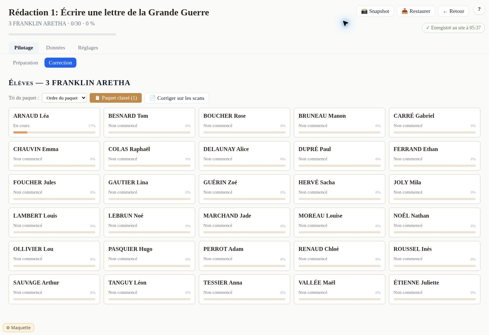

# Livraison C15 — Avancement réel des copies scannées

31/10/2026, 05:46, heure de Paris. Point 59 : le tableau des élèves. **Ça va : banc complet, 75 vérifications, 0 défaut.** Livré pour essai sur la branche `c15-avancement` du sas ; aucune promotion.

## Ce qui change

Une copie scannée dont la langue est terminée ne reste plus « Non commencé · 0 % ». Le tableau compte les rubriques de la grille effectivement terminées, indépendamment de leur poids dans la note. Sur la grille d'essai, la langue termine deux rubriques sur douze : **En cours · 17 %**. Une copie entière est **Corrigé · 100 %**, et le compteur de classe la compte.

Une marque ou une réponse commence la correction ; elle ne termine pas seule une rubrique. Une correction commencée peut donc être « En cours · 0 % » tant qu'aucune rubrique n'est terminée. Une simple ouverture, un chrono ou la recopie seule ne valent pas correction. L'infobulle explique le compte.

Le tableau lit les données existantes, sans créer ni réécrire une copie. Les questions utilisent le calcul de case existant, avec une lecture passée explicitement ; les rubriques calculées lisent la fin de passe enregistrée par Paul. Les copies à repères ne demandent pas de charger leurs photos pour lire cette fin de passe. Le calcul ne change aucune note. Une ancienne note de la grille classique n'est pas présentée comme la note des scans.

## Ouvrir le fichier et rejouer

Télécharger [C15-maquette-avancement-v1-essai1.html](maquette/C15-maquette-avancement-v1-essai1.html), puis ouvrir le fichier dans le navigateur. C'est l'app réelle sur le faux hub, avec la recopie déjà livrée et les 30 noms inventés. Ce lien est un fichier à télécharger, pas une adresse de préproduction.

Ouvrir la rédaction d'essai, puis « Corriger sur les scans ». Charger [la page inventée](maquette/banc/recopie-lignes-essai.png), donner les initiales `la`, Entrée. Saisir 6 lignes écrites, Entrée. Terminer les fautes avec Entrée, puis répondre aux trois questions du Lexique. Quand la passe du thème commence, « ✕ Fermer » : la carte affiche « En cours · 17 % ». Recharger : elle garde ce résultat sans avoir à rouvrir les scans.

La recopie et les quatre passes restent disponibles. Le fichier de production est toujours la 1.2.3-RU.

## Preuves comptées

| Mesure | Résultat |
| --- | --- |
| Référence de recopie reconstruite avant modification | 743 033 octets identiques, blob `81355436fd26d4fb39b62feba92ebe599e58fe29` |
| Sources de travail avant modification | 13 fichiers vérifiés contre leurs blobs, dont la référence de production inchangée |
| Candidate | `1.3.1-RU-C15-1`, 744 785 octets, blob `b5f6e2b9c73f14fed644df0e942a7c5eb3d656a3` |
| SHA-256 | `1a93af50dd2fbd15e952a7e9913a7f3ec0a8dca5092d17815eec0ace01938d1b` |
| Reconstruction depuis les sources | Tous les octets identiques |
| Commit de code éprouvé | `4ec075245a52852cf2e62d4a23862894a42a98f9` |
| Exécution GitHub 41169486032 | Tous les jobs en succès ; « BANC : 75 vérifications, 0 défaut - 30 captures » |
| Épreuves conservées | Les 49 précédentes des scans et les 18 de la recopie |
| Épreuves ajoutées | 8, par les gestes réels |
| Captures livrées et regardées | 7 JPEG : constat avant, résultat après et cinq formats de contrôle |

Les huit épreuves nouvelles vérifient la copie entière à 100 %, la langue seule à 17 %, la copie intacte à 0 %, le compteur une sur trente, les données inchangées au tri, aucune copie réécrite au tri, la reprise sans ouverture des scans ni images, puis la séparation du statut et du pourcentage aux quatre tailles de bureau.

Le défaut a aussi été rejoué à la main dans le navigateur : même copie inventée et mêmes données enregistrées, 0 % avant changement de code, 17 % après rechargement avec le correctif. Les sept JPEG ci-dessous ont été regardés. Les 30 PNG du banc sont produits dans son journal et ne sont pas regardés par C15 ; le verdict et le nombre de captures sont lus dans les métadonnées des jobs.

Sources : `maquette/avancement.js` ; adaptation de `scCase` dans `scan.js` pour recevoir une lecture sans initialiser une copie ; intégration dans `gen-maquette.py`. Les algorithmes de cases et de note existants ne sont pas réécrits. Le chemin de la grille classique reste celui d'avant quand aucune correction sur scans n'est engagée ; son parcours entier n'est pas rejoué ici. Banc unique `maquette/banc/banc.mjs`, complété par `banc/avancement.mjs`. Aucun fichier de l'app en production modifié.

## Captures regardées

Les vues avant/après sont des écrans entiers à 1363 × 936. Les autres montrent le fichier réel dans un cadre aux dimensions indiquées ; pour entrer dans le navigateur, les cadres de 1366, 1536 et 1920 pixels sont présentés à 98 %, 87 % et 70 %. Le JPEG extérieur conserve l'écran entier. Le banc éprouve directement les quatre tailles de bureau.

[Avant](CAPTURES-C15-AVANCEMENT/59a-avant-tableau.jpg)

[1280 × 720](CAPTURES-C15-AVANCEMENT/59a-tableau-1280x720.jpg) · [1366 × 768](CAPTURES-C15-AVANCEMENT/59a-tableau-1366x768.jpg) · [1536 × 864](CAPTURES-C15-AVANCEMENT/59a-tableau-1536x864.jpg) · [1920 × 1080](CAPTURES-C15-AVANCEMENT/59a-tableau-1920x1080.jpg) · [390 × 800](CAPTURES-C15-AVANCEMENT/59a-tableau-390x800.jpg)

Le regard mobile porte sur la carte, dont le statut et le pourcentage restent lisibles. L'en-tête préexistant déborde horizontalement à 390 pixels ; il n'est pas corrigé dans ce périmètre. Le bouton de simulation peut recouvrir le bas de la liste aux petites hauteurs ; il appartient à la maquette. Aucun essai iPhone réel annoncé.

## Suite précise

59 reste ouvert : restent le geste de remise à zéro d'une copie avec la corbeille MJPC, la page ouverte qui ne doit pas ressusciter une copie effacée ailleurs, puis les mots de l'élève à valider. La comparaison privée des anciennes copies et le « promeus » restent avant toute mise en ligne.

La bande 57 attend les décisions indiquées dans [CHOIX-C15-BANDE-57.md](CHOIX-C15-BANDE-57.md). Ce fichier est une proposition, pas une validation de Paul. 58, 53, 45 et 36 gardent leur statut dans le mandat. Aucun gain de temps ni mesure des 30 clics annoncé.
