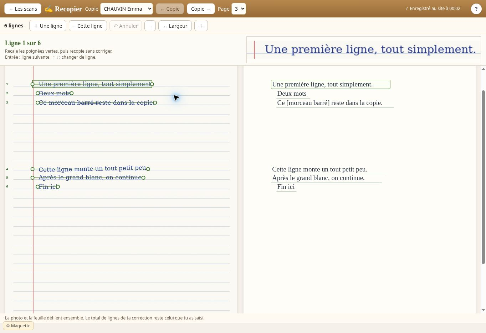

# Livraison C15 — Recopie v1, essai 2

31/10/2026, 00:04, heure de Paris. Intervention 56, sur l'ordre de Paul « Bon et alors il faut coder maintenant !! ». Dépôt sur la branche `c15-recopie` du sas. **Ça va pour cet essai : 67 vérifications, 0 défaut. Aucune promotion.**

## Ouvrir l'essai

Télécharger le fichier complet [C15-maquette-recopie-v1-essai2.html](maquette/C15-maquette-recopie-v1-essai2.html), puis l'ouvrir dans le navigateur. C'est l'app avec son faux hub local, 30 noms inventés et la nouveauté intégrée ; les données du vrai site ne sont pas jointes.

Ouvrir la rédaction d'essai, puis « Corriger sur les scans ». Charger [la page inventée de six lignes](maquette/banc/recopie-lignes-essai.png). Donner les initiales `ec`, Entrée ; cliquer sur « Corriger » si ce bouton est proposé, puis sur « ✍ Recopier ».

Recaler les deux poignées vertes d'une ligne ; taper le texte sans corriger ses fautes ; Entrée passe à la ligne suivante, ↑ et ↓ changent de ligne. Ajouter une ligne, la retirer, puis Annuler. Recharger la page : la même copie, la même page, les lignes recalées et le texte reviennent. « ← Les scans » rend les quatre passes.

Pour essayer le paquet complet, [paquet-essai.pdf](maquette/paquet-essai.pdf) est le PDF inventé du banc. Les initiales employées par le banc sont `ec`, `la`, `mb`, Entrée seule, `tb`, `gc`, `rb` ; la page blanche est écartée. Les initiales se tapent dans le champ, une page après l'autre.

## Ce qui est livré

Photo à gauche, feuille à droite, mêmes dimensions et même défilement ; lignes proposées depuis l'encre, numéros et poignées gauche/droite ; début et pente de la saisie liés à la ligne recalée ; ligne active agrandie au-dessus ; ajout, retrait et annulation ; saisie exacte, sauvegarde sans remplacer le champ actif ; reprise de la copie, de la page et de la ligne ; changement de copie et de page ; zoom commun ; coordonnées transformées lors d'une retouche de photo.

Les lignes ont des identités stables. Leurs textes sont des valeurs. Les nouvelles données ajoutent `scan.recopie` et le curseur `scanRecopie` ; les anciennes marques, réponses, bonnes formes, lignes de correction, notes et photos ne sont ni renommées ni retirées. Les protections `scCles`, `scCleSite` et `scFb` restent en place. Ouvrir un brouillon de recopie ne crée pas seul les données de lignes de la copie.

Sources : `maquette/recopie.js`, `recopie.css`, intégrations dans `scan.js` et `gen-maquette.py`. Banc unique : `maquette/banc/banc.mjs`, complété par `banc/recopie.mjs`, la page PNG et son générateur `banc/fixture-recopie.py`. Construction vérifiée par `banc/verifier-construction.py`. Le fichier élève et la grille en service ne sont pas réécrits.

## Mesures et limites

| Preuve | Résultat |
| --- | --- |
| Référence reconstruite avant modification | 533 112 octets identiques à la 1.2.3-RU, md5 `bde58bd636a12ea3e6af66474b476e38` |
| Candidate livrée | `1.3.0-RU-C15-2`, 743 033 octets |
| Blob Git de la candidate | `81355436fd26d4fb39b62feba92ebe599e58fe29` |
| SHA-256 | `f442e0bb90a1d91b1e820c94d2989c6c4f14202031a943cbc9d16c1468690781` |
| Reconstruction de la candidate depuis les sources | Tous les octets identiques |
| Commit du code et du banc éprouvés | `1d2b837bae67abd1c03667b8ddc78bc82db09337` |
| GitHub Actions, exécution 41141862865 | Tous les jobs terminés avec succès ; « BANC : 67 vérifications, 0 défaut - 26 captures » |
| Épreuves | Les 49 existantes conservées, 18 ajoutées pour la recopie |
| Détection de la page PNG inventée | 6 lignes trouvées sur 6, avec ligne de deux mots, rature, pente et grand blanc |
| Alignement après poignées | Début et pente projetés à 1,5 pixel près |
| Conservation | Anciennes marques, réponses, note, total de lignes et nombre de copies identiques ; reprise après rechargement ; retouche de photo sans perdre identité ni texte |
| Captures livrées et regardées | 6 JPEG, listés ci-dessous |

Le premier essai a passé 64 vérifications (exécution 41139941456), puis 66 (41141369531). Le contrôle supplémentaire de retouche avait d'abord échoué parce que le test cherchait son bouton depuis une autre passe ; le parcours revient désormais à « La langue ». Le contrôle visuel a ensuite montré que les lettres restaient trop grandes sur petit écran : l'essai 2 fait suivre leur taille à celle des feuilles et ajoute l'épreuve des six lignes à 390 pixels. L'essai 1 reste une pièce historique, l'essai 2 est la candidate à essayer.

Les 26 PNG du banc sont produits dans son journal ; C15 ne les a pas récupérés ni regardés. Le verdict est lu dans les métadonnées des jobs. Les six JPEG suivants ont, eux, été ouverts et regardés. Le lanceur utilise une machine standard gratuite du dépôt public, sans artefact, cache, secret ou droit d'écriture GitHub.

Sur trois ou quatre vraies pages entières et sur tous les débuts horizontaux : **je ne sais pas** ; 36 reste ouvert. Les mesures sur la page inventée ne prouvent pas ces cas. Le temps de travail de Paul et ses **30 clics** ne sont pas remesurés ; aucun gain de temps promis.

Sur téléphone, les deux feuilles restent côte à côte avec un défilement horizontal et un zoom ; la saisie est petite à la largeur initiale. Le contrôle à 390 × 800 porte sur la présence des outils, l'accès à la saisie et l'absence de chevauchement dans l'exemple. Ce n'est pas un essai sur iPhone réel ni sur la pièce jointe École Directe.

## Captures regardées

La première image est l'écran entier de l'aperçu direct, 1363 × 936. Les cinq suivantes montrent le même fichier dans un cadre de navigation aux dimensions indiquées, sans changement de son contenu ; l'écran entier est conservé dans le JPEG. Les vues de bureau trop grandes pour le navigateur sont réduites visuellement à 98 %, 87 % et 70 %, et leur cadre garde respectivement 1366 × 768, 1536 × 864 et 1920 × 1080. Le banc mesure aussi directement ces quatre tailles de bureau.

[1280 × 720](CAPTURES-C15-RECOPIE-V1/C15-recopie-v1-essai2-1280x720.jpg) · [1366 × 768](CAPTURES-C15-RECOPIE-V1/C15-recopie-v1-essai2-1366x768.jpg) · [1536 × 864](CAPTURES-C15-RECOPIE-V1/C15-recopie-v1-essai2-1536x864.jpg) · [1920 × 1080](CAPTURES-C15-RECOPIE-V1/C15-recopie-v1-essai2-1920x1080.jpg) · [390 × 800](CAPTURES-C15-RECOPIE-V1/C15-recopie-v1-essai2-390x800.jpg)

## Suite et conditions de mise en ligne

56 est codé et livré pour essai au sas. 57, la bande des fautes, et 58, les stickers, ne sont pas codés dans cette livraison. 53 n'est pas validé : aucun import de fichier de recopies. Les quatre passes restent ; 45 attend la grille. Les touches 51 et le traitement des doublons d'anciennes fautes sont à cadrer avant 57.

⑪ reste ouverte pour la suite. Avant toute promotion : 59 entier (avancement de la tuile, remise à zéro d'une copie et page restée ouverte, mots vus par l'élève validés), comparaison privée des vraies copies sur le même instantané en lecture seule, banc complet, audit et mot « promeus » de Paul. Le fichier de production reste la 1.2.3-RU.

## Registre — mise à jour en attente

La note de livraison pour ⑪ n'a pas été appliquée au registre de production. Le contrôle automatique a refusé la réécriture du fichier public complet, en raison de son historique potentiellement sensible ; aucune autre voie n'a été essayée. [L'ajout technique exact préparé](NOTE-REGISTRE-C15-RECOPIE-V1.md) ajoute 1 319 caractères et conserve les 806 985 caractères existants. L'autorisation explicite sur cet ajout reste à recueillir. La livraison de la recopie au sas, ses tests et ses preuves sont terminés.
